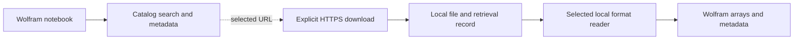

# BioDataLink design

BioDataLink connects Wolfram Language to biological source metadata, chosen
data files and supported local measurements. Broader coverage of sequences,
structures, images, pathways, biodiversity and controlled sources remains a
design goal. See the [build index](build-index.md) for current functions and
the [roadmap](../ROADMAP.md) for planned work.

## Intended researcher workflow

1. Find a source or study.
2. Check identifiers, assay, sampling, processing and access terms.
3. Choose a file and download it with integrity checks.
4. Import a supported representation, retaining metadata and provenance.

A study can produce several files and catalog entries. Discovery, download
and native import are separate capabilities.

## Architecture

The kernel owns public operations and validation. Provider adapters describe
source records; format readers convert files into ordinary Wolfram values.
Metadata queries use Wolfram Language, streamed downloads use curl, and H5AD
reading uses explicitly configured Python with h5py/NumPy. Installing the core
paclet installs no optional backend. Package loading stays offline.

## Implemented capabilities

| Task | Current support | Important limit |
| --- | --- | --- |
| Source discovery | Identifiers.org: 867 namespaces, 1,039 endpoints; 774 active namespaces shown by default | Directory membership does not establish access or a data connection |
| Resolver links | `BioDataURL`, preserving full embedded-prefix IDs and case | No accession existence or source-pattern validation |
| Live metadata | BioStudies studies and GEO Series, one page per call | No study-to-file retrieval; indexes can change |
| Offline catalog | 55 pinned Pertpy loader records | Not 55 independent studies; import flags remain false |
| Download | Explicit HTTPS URL, size limit, optional expected size/hash, validated placement | Requires curl 8.4+; no cache, retry, resume or extraction |
| Local import | BioDataLink JSON and selected supported dense/CSR/CSC H5AD matrices | H5AD is a selection, not a full AnnData conversion |

The source registry retains complete records and CC BY 4.0 attribution. Pertpy
descriptions remain source declarations; absent organism metadata stay unknown.
Generic H5AD support does not independently verify catalog artifacts.

## Performance and query boundaries

Validated registry and catalog snapshots are cached by path per kernel, with
indexes built once. Restart after explicitly updating a bundled snapshot.
Live searches paginate; GEO summaries are batched. Time limits include pacing.
Follow cursors rather than estimated totals, and retain selected accessions.

GEO keys are credential references for public quotas, not private access.
Secrets and request query values stay out of failures. H5AD selection and
transfer limits do not bound every HDF5 chunk read or all interpreter memory.

## Common data semantics

JSON rows are cells and columns are genes, with unique IDs per axis. AnnData
axes are observations and variables, which can represent other entities.
H5AD selections preserve duplicate labels and unique one-based source positions.
Do not join solely on repeated display labels.

JSON scale and provenance are required declarations. `Counts` validates
nonnegative integers, not read/molecule identity or preprocessing. Every omitted
entry is zero; there is no missing-measurement mask. Unsupported missingness
must be preserved elsewhere or excluded through a documented selection.

H5AD normalization stays unspecified regardless of layer name. Missing
annotations are preserved; selected nonfinite measurements are rejected.
Categorical metadata retain ordering and selected source levels. Results list
omitted structures rather than presenting a partial read as complete.

## Reproducible retrieval

Keep source identity, revision, selected file, bytes, hash and citation.
Expected and computed hashes are distinct evidence. The JSON hash covers the
same bounded bytes parsed. H5AD records size and modification time but avoids
a full-file hash; retain a download record when stronger identity is needed.
Future caches must apply the same validation as a fresh transfer.

## Verification

Default tests and notebook builds use local fixtures. Live checks are opt-in
and record source, revision, time and transfer evidence. Before advertising a
provider import, independently check dimensions, labels, values, missingness,
integrity and failures; an exporter/reader round trip alone is insufficient.

## Source references

- [Identifiers.org API](https://docs.identifiers.org/pages/api.html) and [terms](https://docs.identifiers.org/pages/terms_of_use.html)
- [BioStudies](https://www.ebi.ac.uk/biostudies/)
- [GEO programmatic access](https://www.ncbi.nlm.nih.gov/geo/info/geo_paccess.html)
- [Pertpy catalog](https://pertpy.scverse.org/en/stable/api/datasets_index.html) and [scPerturb](https://projects.sanderlab.org/scperturb/)
- [CELLxGENE Census](https://chanzuckerberg.github.io/cellxgene-census/) for planned versioned subsets
- [DISCOSingleCellAtlas (WFR)](https://resources.wolframcloud.com/FunctionRepository/resources/DISCOSingleCellAtlas/) for an existing tissue-level interface
