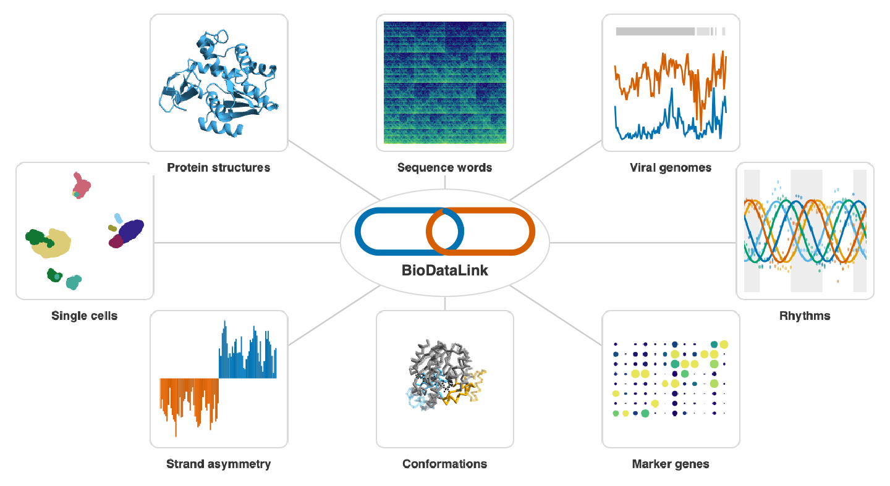

## Abstract

BioDataLink provides source discovery, study search, file downloads and local
matrix import. It supports the Identifiers.org directory, Pertpy catalog,
BioStudies and GEO metadata, BioDataLink JSON and selected AnnData H5AD data.
Results retain identifiers, metadata and provenance.

WL denotes a built-in Wolfram Language function.

## Functions

### [Data Sources](paclet:WolframInstitute/BioDataLink/guide/Sources)

- `BioDataSourceInfo` inspect source metadata and identifier conventions
- `BioDataSourceSearch` find registered data sources
- `BioDataURL` construct a resolver URL from an accession

### [Online Study Search](paclet:WolframInstitute/BioDataLink/guide/Providers)

- `BioDatasetQuery` search BioStudies or GEO study metadata

### [Catalog](paclet:WolframInstitute/BioDataLink/guide/Catalog)

- `BioDatasetInfo` get a catalog record and its provenance
- `BioDatasetSearch` search the bundled dataset catalog

### [Data Access](paclet:WolframInstitute/BioDataLink/guide/DataAccess)

- `BioDatasetLoad` import a local matrix with aligned metadata
- `Dataset` (WL) query and display structured metadata
- `SparseArray` (WL) represent arrays with implicit zero entries

### [Data File Downloads](paclet:WolframInstitute/BioDataLink/guide/Downloads)

- `BioDatasetDownload` download an HTTPS file with integrity checks

### [Computational Explorations](paclet:WolframInstitute/BioDataLink/guide/ComputationalExplorations)

- `ClusteringComponents` (WL) assign observations to clusters
- `DimensionReduce` (WL) project measurements into fewer dimensions
- `PrincipalComponents` (WL) compute principal components of measurements
- `Quantile` (WL) find cutoffs for rank-based bins
- `SequenceAlignment` (WL) align two sequences

### [Visualizing Biological Data](paclet:WolframInstitute/BioDataLink/guide/Visualizations)

- `BioEmbeddingPlot` align coordinates and annotations by observation ID
- `BioExpressionDotPlot` compare mean expression and detection fractions
- `BioSequenceCompositionPlot` show overlapping DNA-word counts
- `BioSequenceSkewPlot` plot composition in complete DNA windows
- `BioStructureComparisonPlot` align and compare residue-keyed traces
