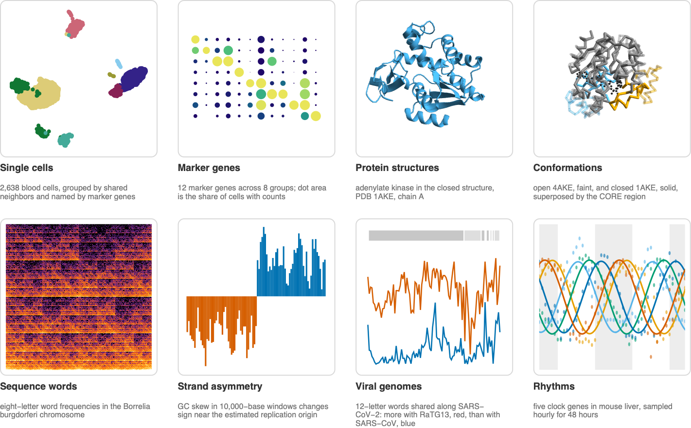

## Abstract

Analyze single-cell expression, protein structures, genome composition and
circadian rhythms using bundled public data. Further examples explore
measurement scales, similarity, prediction and model comparison using Iris
measurements or labeled synthetic data.

WL denotes a built-in Wolfram Language function.

## Functions

### Analyze Real Biological Data

- `BioDatasetLoad` import a local matrix with aligned metadata
- `BioMoleculeValue` (WL) extract molecular coordinates and properties
- `DimensionReduce` (WL) project measurements into fewer dimensions
- `FindGeometricTransform` (WL) align structures by rotation and translation
- `FindGraphCommunities` (WL) identify communities in a graph
- `Fourier` (WL) compute frequency components of a time series
- `LeastSquares` (WL) fit a linear model

### Keep the Measurements and Their Meaning Together

- `BioDatasetDownload` download an HTTPS file with integrity checks
- `BioDatasetLoad` import a local matrix with aligned metadata
- `Dataset` (WL) query and display structured metadata
- `SparseArray` (WL) represent arrays with implicit zero entries

### Explore Geometry and Representation

- `ClusteringComponents` (WL) assign observations to clusters
- `EuclideanDistance` (WL) measure distance between feature vectors
- `PrincipalComponents` (WL) compute principal components of measurements
- `Quantile` (WL) find cutoffs for rank-based bins

### Compare Finite Computational Hypotheses

- `ArrayPlot` (WL) display arrays of values
- `CellularAutomaton` (WL) evolve a specified cellular automaton rule
- `Graph` (WL) represent relationships between observations or models
- `Outer` (WL) evaluate all combinations of inputs
- `Subsets` (WL) enumerate candidate measurement panels
- `VertexCoordinates` (WL) specify fixed graph positions

## References

- [10x Genomics 3k PBMCs from a Healthy Donor](https://www.10xgenomics.com/datasets/3-k-pbm-cs-from-a-healthy-donor-1-standard-1-1-0)
- [GEO series GSE11923, mouse liver time series](https://www.ncbi.nlm.nih.gov/geo/query/acc.cgi?acc=GSE11923)
- [NCBI RefSeq NC_001318.1, *Borrelia burgdorferi* B31 chromosome](https://www.ncbi.nlm.nih.gov/nuccore/NC_001318.1)
- [NCBI RefSeq NC_045512.2, SARS-CoV-2 Wuhan-Hu-1](https://www.ncbi.nlm.nih.gov/nuccore/NC_045512.2)
- [Protein Data Bank entry 1AKE](https://www.rcsb.org/structure/1AKE)
- [Protein Data Bank entry 4AKE](https://www.rcsb.org/structure/4AKE)
- [Ruliobiology finite cellular automata](https://www.wolframcloud.com/obj/wolframinstitute/DeployedResources/Paclet/WolframInstitute/Ruliobiology/Documentation/ref/FiniteCellularAutomaton.html)
- [Ruliology rule-space tutorial](https://www.wolframcloud.com/obj/wolframinstitute/DeployedResources/Paclet/WolframInstitute/Ruliology/Documentation/tutorial/AnalyzingCellularAutomatonRuleSpace.html)
- [UCI Iris dataset](https://archive.ics.uci.edu/dataset/53/iris)
