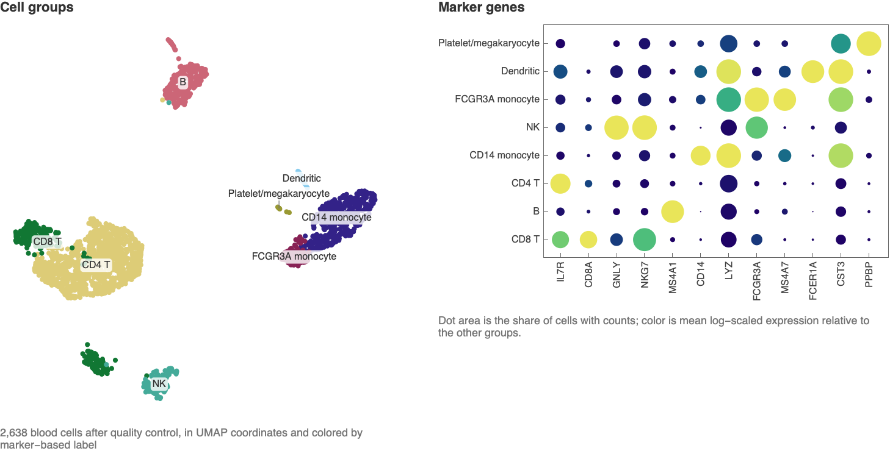

Identify provisional blood-cell types from the
[10x Genomics PBMC3k dataset](https://www.10xgenomics.com/datasets/3-k-pbm-cs-from-a-healthy-donor-1-standard-1-1-0)
(CC BY 4.0). The bundled subset contains 2,700 cells and 513 of 32,738 genes
from one donor. UMI counts estimate captured RNA molecules after deduplication;
zeros can reflect sampling loss.

The examples below end with these cell groups and the marker genes behind their labels:



Evaluate **Initialization**, then run the examples in order.

## Load the counts

Rows are cells; columns are genes. Keep the source and selection record:

```wl
pbmc = BioDatasetLoad[File[FileNameJoin[{PacletObject["WolframInstitute/BioDataLink"]["AssetLocation", "Examples"], "PBMC3k", "pbmc3k-subset.json"}]]];
pbmc["ExpressionMatrix"]
```

Inspect the source and gene selection:

```wl
KeyTake[pbmc["Provenance"], {"Source", "License", "SourceSHA256", "Selection"}]
```

The gene metadata identify 300 highly variable genes, markers and reference
genes. Use Ensembl IDs for joins; symbols are display labels.

```wl
pbmc["GeneMetadata"][1 ;; 5]
```

Per-cell totals and detected-gene counts refer to all 32,738 source genes:

```wl
counts = pbmc["ExpressionMatrix"];
symbols = Normal[pbmc["GeneMetadata"][All, "Symbol"]];
gene = First /@ PositionIndex[symbols];
variable = geneSet[pbmc, "HighlyVariable"];
totals = Normal[pbmc["CellMetadata"][All, "SourceTotalCounts"]];
detected = Normal[pbmc["CellMetadata"][All, "SourceGenesDetected"]];
```

## Filter cells

Plot detected genes against total counts, colored by mitochondrial percentage:

```wl
mitoFraction = N[Normal[Total[counts[[All, geneSet[pbmc, "Mitochondrial"]]], {2}]]/totals];
```

Display the quality-control measurements:

```wl
ListLogLogPlot[MapThread[Style, {Transpose[{totals, detected}], ColorData["BlueGreenYellow"] /@ Rescale[Clip[mitoFraction, {0, 0.1}], {0, 0.1}]}],
    Frame -> True, FrameLabel -> {"UMI counts per cell", "genes detected"}, GridLines -> {None, {200, 2500}},
    PlotLegends -> BarLegend[{"BlueGreenYellow", {0, 10}}, LegendLabel -> "% mitochondrial (capped at 10)"]]
```

Use the [Seurat example](https://satijalab.org/seurat/articles/pbmc3k_tutorial)
thresholds: 200–2,500 detected genes and less than 5% mitochondrial counts.
These are assay-specific screens for low-quality cells and possible doublets,
not diagnoses.

```wl
keep = Flatten[Position[MapThread[200 <= #1 <= 2500 && #2 < 0.05 &, {detected, mitoFraction}], True]];
kept = counts[[keep]];
Length[keep]
```

## Reduce technical variation

[Pearson residuals](https://doi.org/10.1186/s13059-021-02451-7) compare observed
counts with counts expected from cell totals and gene abundance. The helper
uses negative-binomial overdispersion 100 and clips at ±√(number of cells).

```wl
residuals = pearsonResiduals[kept, totals[[keep]]];
Dimensions[residuals]
```

Apply principal component analysis (PCA) to the 300 selected genes:

```wl
pcs = PrincipalComponents[residuals[[All, variable]], Method -> "Covariance"];
```

Plot the variance explained by each component:

```wl
With[{v = Variance[pcs]}, ListPlot[Take[v/Total[v], 40], Filling -> Axis, PlotRange -> All, Frame -> True, FrameLabel -> {"principal component", "fraction of variance"}]]
```

The variance curve flattens near 20 components; retain those for clustering.
Gene correlations help interpret the first two components:

```wl
With[{r = Correlation[residuals[[All, variable]], pcs[[All, ;; 2]]]},
    ListPlot[MapThread[Callout, {r, symbols[[variable]]}], PlotRange -> All, Frame -> True, FrameLabel -> {"correlation with PC 1", "correlation with PC 2"}, AspectRatio -> 1]]
```

Myeloid genes such as `LYZ` and `S100A9` oppose ribosomal and T-cell genes on
PC 1. Platelet genes `PPBP` and `GP9` extend along negative PC 2. Component
signs are arbitrary.

## Group and label cells

UMAP maps local neighborhoods into two dimensions. Cluster the first 20 PCs
using 12 neighbors, Jaccard-weighted edges and modularity communities:

```wl
umap = DimensionReduce[pcs[[All, ;; 20]], 2, Method -> "UMAP", RandomSeeding -> 1];
```

Find communities in the neighbor graph:

```wl
clusters = graphClusters[pcs[[All, ;; 20]], 12, 20261104];
```

For marker display, scale counts to 10,000 per cell and use `Log[1 + x]`:

```wl
logExpression = Log[1. + kept 10000/totals[[keep]]];
```

Display marker expression on the UMAP coordinates:

```wl
GraphicsGrid[Partition[featurePlot[umap, logExpression[[All, gene[#]]], #] & /@ {"CCR7", "S100A4", "CD8A", "NKG7", "MS4A1", "CD14", "FCGR3A", "PPBP"}, 4], ImageSize -> Large]
```

Markers overlap across cell types. Score communities using the
[Scanpy marker sets](https://scanpy.readthedocs.io/en/stable/tutorials/basics/clustering-2017.html):

```wl
markerSets = <|"CD4 T" -> {"IL7R"}, "CD8 T" -> {"CD8A"}, "NK" -> {"GNLY", "NKG7"}, "B" -> {"MS4A1"},
    "CD14 monocyte" -> {"CD14", "LYZ"}, "FCGR3A monocyte" -> {"FCGR3A", "MS4A7"}, "Dendritic" -> {"FCER1A", "CST3"}, "Platelet/megakaryocyte" -> {"PPBP"}|>;
scores = markerScores[logExpression, clusters, Map[gene, markerSets, {2}]];
```

The heat map shows standardized mean marker expression: rows are candidate
types, columns are communities.

```wl
Legended[MatrixPlot[Transpose[scores],
    ColorFunction -> (ColorData["ThermometerColors"][Rescale[#, {-3, 3}]] &), ColorFunctionScaling -> False,
    PlotRange -> {-3, 3}, FrameTicks -> {{Transpose[{Range[Length[markerSets]], Keys[markerSets]}], None}, {Automatic, None}}],
    BarLegend[{"ThermometerColors", {-3, 3}}]]
```

Assign the highest-scoring type to each community. This forces a label even
for a poor match; it is not a calibrated classifier.

```wl
clusterType = Keys[markerSets][[Flatten[Ordering[#, -1] & /@ scores]]];
cellType = clusterType[[clusters]];
Counts[cellType]
```

Compare PCA and UMAP using the same labels and all retained cells:

```wl
Row[{mapPlot[pcs[[All, ;; 2]], cellType, PlotStyle -> tolMuted, PlotLegends -> None], mapPlot[umap, cellType, PlotStyle -> tolMuted]}]
```

Platelet-labeled cells extend far along PC 2. UMAP separates local neighborhoods,
but distances between islands and their sizes are not reliable biological
measurements ([Chari and Pachter 2023](https://doi.org/10.1371/journal.pcbi.1011288);
[Lause et al. 2024](https://doi.org/10.1371/journal.pcbi.1012403)).

```wl
BarChart[KeySort[Counts[cellType]], ChartStyle -> tolMuted, ChartLabels -> Automatic, BarOrigin -> Left, LabelingFunction -> After]
```

These proportions describe captured cells passing the filters, not blood
composition. Capture efficiency and RNA content differ by cell type.

## How much does preprocessing change the picture?

Treat preprocessing as an experiment. Compare three representations of the
same cells and genes: raw counts, library-scaled log counts, and Pearson
residuals. These transformations answer different questions about abundance.

```wl
representationPCs = {PrincipalComponents[N[Normal[kept[[All, variable]]]], Method -> "Covariance"],
    PrincipalComponents[Normal[logExpression[[All, variable]]], Method -> "Covariance"], pcs};
cellIDs = Normal[pbmc["CellMetadata"][All, "ID"]][[keep]];
cellAnnotations = AssociationThread[cellIDs, cellType];
GraphicsRow[MapThread[BioEmbeddingPlot[AssociationThread[cellIDs, #1[[All, ;; 2]]], cellAnnotations,
    PlotLegends -> None, FrameLabel -> {"PC 1", "PC 2"}, PlotLabel -> #2] &,
    {representationPCs, {"raw counts", "scaled log counts", "Pearson residuals"}}], ImageSize -> Large]
```

All panels use the same cells and category colors. Axis units differ. Look for
populations whose apparent separation depends on the representation.

Measure how strongly the first ten components track library size:

```wl
ListLinePlot[Function[scores, Abs[(Correlation[Log[N[totals[[keep]]]], #] &) /@ Transpose[scores[[All, ;; 10]]]]] /@ representationPCs,
    Frame -> True, PlotRange -> {0, 1}, FrameLabel -> {"principal component", "absolute correlation with log library size"},
    PlotLegends -> {"raw counts", "scaled log counts", "Pearson residuals"}]
```

A reduced association with depth is useful evidence about a technical effect.
It does not prove that every removed direction was technical: cell types also
differ in RNA content.

## Read the evidence behind the labels

A large dot means that many cells have nonzero expression. Color reports mean
log expression, rescaled separately for each gene. Compare groups within a
column; colors across columns are not absolute abundance comparisons.

```wl
markerGenes = DeleteDuplicates[Catenate[Values[markerSets]]];
BioExpressionDotPlot[logExpression[[All, gene /@ markerGenes]], cellType, markerGenes,
    "ColorScaling" -> "PerFeature", ImageSize -> Large]
```

A high average can come from a few bright cells. Inspect the distribution and
fraction detected for `MS4A1`, which contributes to the B-cell label:

```wl
With[{groups = Values[KeySort[PositionIndex[cellType]]], labels = Keys[KeySort[PositionIndex[cellType]]]},
    BoxWhiskerChart[Normal[logExpression[[#, gene["MS4A1"]]]] & /@ groups,
        ChartLabels -> Placed[labels, Below], PlotRange -> All,
        FrameLabel -> {"provisional type", "MS4A1 log-scaled counts"}, ImageSize -> Large]]
```

These are descriptive marker checks on the same data used to assign labels.
They are not independent validation of those labels.

Compare mere detection with a higher display threshold. The denominator still
includes every cell in each group; the color scale still uses the mean of all
values, including zeros:

```wl
GraphicsRow[Table[BioExpressionDotPlot[logExpression[[All, gene /@ {"MS4A1", "CD14", "NKG7", "PPBP"}]],
    cellType, {"MS4A1", "CD14", "NKG7", "PPBP"}, "DetectionThreshold" -> t,
    "ColorScaling" -> "PerFeature", PlotLegends -> None, PlotLabel -> Row[{"threshold = ", t}]],
    {t, {0, Log[2.]}}], ImageSize -> Large]
```

## Test a label without one of its markers

Remove each gene from the NK marker set, one at a time, and recompute all
community labels. Keep the graph fixed so this experiment isolates marker
choice rather than clustering randomness.

```wl
nkLabelRuns = Table[With[{sets = ReplacePart[markerSets, "NK" -> remaining]},
    With[{labels = Keys[sets][[Flatten[Ordering[#, -1] & /@ markerScores[logExpression, clusters, Map[gene, sets, {2}]]]]]}, labels[[clusters]]]],
    {remaining, {{"GNLY"}, {"NKG7"}}}];
GraphicsRow[MapThread[BioEmbeddingPlot[AssociationThread[cellIDs, umap], AssociationThread[cellIDs, #1],
    "CategoryColors" -> AssociationThread[Sort[Keys[markerSets]], Take[tolMuted, Length[markerSets]]],
    PlotLegends -> None, PlotLabel -> #2] &, {nkLabelRuns, {"NK: GNLY alone", "NK: NKG7 alone"}}], ImageSize -> Large]
```

Count changed labels by the original provisional type:

```wl
Dataset[AssociationMap[Function[type, With[{indices = Flatten[Position[cellType, type]]},
    AssociationThread[{"GNLY alone", "NKG7 alone"},
        N[Mean[Boole[MapThread[UnsameQ, {cellType[[indices]], #[[indices]]}]]]] & /@ nkLabelRuns]]], Sort[Keys[markerSets]]]]
```

Stability to this deletion supports redundancy within the chosen marker panel.
Instability identifies labels worth checking with an external reference.

## Quantify what the embedding preserves

UMAP is a display of local relationships, not the space in which the graph was
constructed. Compare each cell's ten nearest neighbors in the first 20 PCs
with its ten nearest neighbors in each two-dimensional representation:

```wl
pcNeighbors = localNeighbors[pcs[[All, ;; 20]], 10];
embeddingNeighbors = localNeighbors[#, 10] & /@ {pcs[[All, ;; 2]], umap};
neighborRetention = Map[MapThread[N[Length[Intersection[#1, #2]]/10] &, {pcNeighbors, #}] &, embeddingNeighbors];
Histogram[neighborRetention, {0, 1.1, 0.1}, "Probability", ChartLegends -> {"first two PCs", "UMAP"},
    Frame -> True, FrameLabel -> {"fraction of PC-space neighbors retained", "fraction of cells"}]
```

This score measures agreement with the selected PC representation. It cannot
establish that this representation is biologically correct.

Run UMAP with a second seed while keeping the analysis and labels fixed:

```wl
umapSecond = DimensionReduce[pcs[[All, ;; 20]], 2, Method -> "UMAP", RandomSeeding -> 2];
GraphicsRow[MapThread[BioEmbeddingPlot[AssociationThread[cellIDs, #1], cellAnnotations,
    PlotLegends -> None, PlotLabel -> #2] &, {{umap, umapSecond}, {"UMAP seed 1", "UMAP seed 2"}}], ImageSize -> Large]
```

Rotations and rearrangements of islands do not by themselves mean that local
relationships changed. Use neighborhood retention rather than comparing
screen positions or island areas.

## Ask how many cells a rare group needs

Subsampling can erase a small captured population. Under independent sampling
from the observed type proportions, the probability of retaining at least one
cell of a type with fraction p is 1 − (1 − p)^n:

```wl
sampleSizes = {25, 50, 100, 250, 500, 1000};
typeFractions = N[KeySort[Counts[cellType]]/Length[cellType]];
ListLinePlot[Table[Transpose[{sampleSizes, 1 - (1 - p)^sampleSizes}], {p, Values[typeFractions]}],
    ScalingFunctions -> {"Log", None}, PlotRange -> {0, 1}, PlotStyle -> Take[tolMuted, Length[typeFractions]], PlotLegends -> Keys[typeFractions],
    Frame -> True, FrameLabel -> {"cells sampled", "probability of retaining at least one"}]
```

This is a sampling calculation conditional on captured-cell frequencies.
It does not estimate prevalence in blood, and one observed cell is insufficient
to establish a reproducible population.

Vary quality-control cutoffs without assigning labels to rejected cells:

```wl
qcCounts = Table[Count[MapThread[200 <= #1 <= upper && #2 < mt &, {detected, mitoFraction}], True],
    {upper, {1500, 2000, 2500, 3000}}, {mt, {0.03, 0.05, 0.08, 0.1}}];
MatrixPlot[qcCounts, PlotLegends -> Automatic, FrameLabel -> {"maximum detected genes", "mitochondrial fraction cutoff"},
    FrameTicks -> {{Transpose[{Range[4], {1500, 2000, 2500, 3000}}], None}, {Transpose[{Range[4], {0.03, 0.05, 0.08, 0.1}}], None}}]
```

The map shows retention, not an optimal threshold. A useful setting also needs
assay knowledge, inspection of the excluded cells, and sensitivity of the
conclusions to those exclusions.

## Check sensitivity and interpretation

Compare 5, 12 and 40 neighbors with the same UMAP coordinates:

```wl
GraphicsRow[Table[With[{labels = graphClusters[pcs[[All, ;; 20]], k, 20261104]},
    mapPlot[umap, labels, PlotLegends -> None, PlotLabel -> Row[{k, " neighbors: ", Max[labels], " communities"}]]], {k, {5, 12, 40}}], ImageSize -> Large]
```

Smaller neighborhoods split groups; larger ones merge related populations.
The 12-neighbor setting distinguishes the two monocyte marker patterns here.
Validate labels with independent reference data before drawing biological
conclusions. Cells from one donor are not independent biological replicates;
condition comparisons need multiple donors.

For a fuller workflow, see
[Luecken and Theis 2019](https://doi.org/10.15252/msb.20188746).

## Initialization

Helpers for residuals, Jaccard-weighted communities, marker scores and plots.
Colors use Paul Tol's muted palette.

```wl
tolMuted = RGBColor /@ {"#CC6677", "#332288", "#DDCC77", "#117733", "#88CCEE", "#882255", "#44AA99", "#999933", "#AA4499"};
geneSet[data_, flag_] := Flatten[Position[Normal[data["GeneMetadata"][All, flag]], True]];
pearsonResiduals[x_, n_] := With[{mu = Outer[Times, N[n], Normal[Total[x]]/Total[n]]},
    Clip[(Normal[x] - mu)/Sqrt[mu + mu^2/100], {-1, 1} Sqrt[N[Length[n]]]]];
```

```wl
graphClusters[x_, k_, seed_] := Module[{index, near, links, communities, labels},
    index = Nearest[x -> "Index"];
    near = Table[Prepend[Take[DeleteCases[index[x[[i]], k + 1], i], k], i], {i, Length[x]}];
    links = Union[Sort /@ Catenate[Thread[{First[#], Rest[#]}] & /@ near]];
    communities = BlockRandom[SeedRandom[seed]; FindGraphCommunities[
        Graph[Range[Length[x]], UndirectedEdge @@@ links,
            EdgeWeight -> (N[Length[Intersection @@ near[[#]]]/Length[Union @@ near[[#]]]] & /@ links)],
        Method -> "Modularity"]];
    labels = ConstantArray[0, Length[x]];
    Do[labels[[communities[[c]]]] = c, {c, Length[communities]}];
    labels];
```

```wl
mapPlot[xy_, labels_, opts___] := With[{groups = KeySort[GroupBy[Thread[labels -> xy], First -> Last]]},
    ListPlot[Values[groups], opts, PlotRange -> All, PlotLegends -> Keys[groups], BaseStyle -> PointSize[0.006], AspectRatio -> 1, Frame -> True, FrameTicks -> None, Axes -> False, ImageSize -> 320]];
featurePlot[xy_, values_, label_] := With[{x = Normal[values], order = Ordering[Normal[values]]},
    Graphics[{PointSize[Small], Point[xy[[order]], VertexColors -> (ColorData[{"LakeColors", "Reverse"}] /@ Rescale[x[[order]]])]},
        PlotLabel -> label, Frame -> True, FrameTicks -> None, AspectRatio -> 1]];
markerScores[expression_, labels_, sets_] := Transpose[Table[
    Mean /@ Standardize[Table[Mean[Normal[expression[[Flatten[Position[labels, c]], set]]]], {c, Max[labels]}]], {set, Values[sets]}]];
```

```wl
localNeighbors[x_, k_] := With[{index = Nearest[x -> "Index"]},
    Table[Take[DeleteCases[index[x[[i]], k + 1], i], k], {i, Length[x]}]];
```