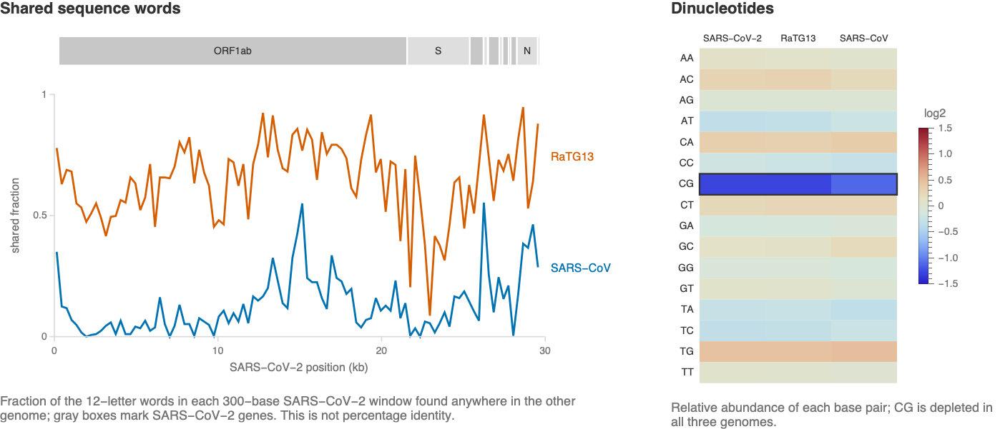

Compare genome organization, shared sequence words and base-pair composition
in three published records: SARS-CoV-2 Wuhan-Hu-1, NC_045512.2
([Wu et al. 2020](https://doi.org/10.1038/s41586-020-2008-3)); RaTG13,
MN996532.2 ([Zhou et al. 2020](https://doi.org/10.1038/s41586-020-2012-7));
and SARS-CoV Tor2, NC_004718.3
([Marra et al. 2003](https://doi.org/10.1126/science.1085953)).

The examples below compare shared sequence words and dinucleotide composition:



These are descriptive sequence comparisons. They do not measure infectivity,
host range or functional effects. Evaluate **Initialization**, then run the examples in order.

## Load the bundled records

Read the NCBI sequences and gene annotations:

```wl
accessions = <|"SARS-CoV-2" -> "NC_045512.2", "RaTG13" -> "MN996532.2", "SARS-CoV" -> "NC_004718.3"|>;
genomes = First[Import[example[# <> ".fasta.gz"], "Sequence"]] & /@ accessions;
StringLength /@ genomes
```

Read the corresponding gene annotations:

```wl
genes = readGenes[example[# <> ".gff3.gz"]] & /@ accessions;
genes["SARS-CoV-2"]
```

The RNA genomes contain about 30,000 bases, represented with DNA letters.
Plot the annotated SARS-CoV-2 genes, one per row:

```wl
genomeMap[genes["SARS-CoV-2"]]
```

## Compare exact shared words

Each point marks positions sharing an identical 12-base word:

```wl
GraphicsRow[Table[ListPlot[kmerMatches[genomes["SARS-CoV-2"], genomes[other], 12], PlotStyle -> PointSize[Tiny], AspectRatio -> 1,
    Frame -> True, FrameLabel -> {"SARS-CoV-2 position", other <> " position"}], {other, {"RaTG13", "SARS-CoV"}}], ImageSize -> Large]
```

The dominant diagonals indicate broadly conserved organization. The SARS-CoV
comparison has fewer exact matches. A dot plot is not a complete alignment.

For each complete 300-base SARS-CoV-2 window, count the fraction of 12-base
words found anywhere in the other genome. Omit the final partial window:

```wl
ListLinePlot[Table[sharedWords[genomes["SARS-CoV-2"], genomes[other], 12, 300], {other, {"RaTG13", "SARS-CoV"}}],
    PlotRange -> {0, 1}, PlotLegends -> {"RaTG13", "SARS-CoV"},
    Frame -> True, FrameLabel -> {"SARS-CoV-2 position", "shared 12-letter words"}]
```

RaTG13 generally shares more words with this SARS-CoV-2 record. Word length
and window size determine sensitivity and resolution; shared-word fractions
are not percentage sequence identity.

## Compare composition

[Relative dinucleotide abundance](https://doi.org/10.1016/s0168-9525%2800%2989076-9)
is the observed adjacent-pair frequency divided by the product of its base
frequencies. On the log2 scale, zero means agreement with that reference;
blue is lower and red is higher.

```wl
With[{pairs = StringJoin /@ Tuples[{"A", "C", "G", "T"}, 2]},
    Legended[MatrixPlot[Log2[Outer[relativeAbundance, Values[genomes], pairs]],
        ColorFunction -> (ColorData["ThermometerColors"][Rescale[#, {-1.5, 1.5}]] &), ColorFunctionScaling -> False, PlotRange -> {-1.5, 1.5},
        FrameTicks -> {{Transpose[{Range[3], Keys[genomes]}], None}, {Transpose[{Range[16], pairs}], None}}],
        BarLegend[{"ThermometerColors", {-1.5, 1.5}}]]]
```

Compare CG relative abundance:

```wl
relativeAbundance[#, "CG"] & /@ genomes
```

CG relative abundance is about 0.41 in SARS-CoV-2 and RaTG13 and 0.46 in
SARS-CoV. This statistic does not identify the process causing the composition.

Three records do not represent viral diversity or establish evolutionary
history. Recombination, ancestry and biological function require other data
and analyses.

## Initialization

Helpers read annotations and count exact words and adjacent-base pairs.

```wl
okabeIto = RGBColor /@ {"#E69F00", "#56B4E9", "#009E73", "#F0E442", "#0072B2", "#D55E00", "#CC79A7", "#000000"};
example[file_] := FileNameJoin[{PacletObject["WolframInstitute/BioDataLink"]["AssetLocation", "Examples"], "Coronaviruses", file}];
readGenes[file_] := Association[Cases[Import[file, "TSV", "MissingValuePattern" -> None],
    {_, _, "gene", start_, end_, _, _, _, attributes_} :> First[StringCases[attributes, RegularExpression["Name=([^;]+)"] -> "$1"]] -> {start, end}]];
genomeMap[map_] := Graphics[MapIndexed[{okabeIto[[5]], Rectangle[{#1[[2, 1]], -First[#2]}, {#1[[2, 2]], 0.7 - First[#2]}], Black,
    Text[#1[[1]], {#1[[2, 2]] + 300, 0.35 - First[#2]}, {-1, 0}]} &, List @@@ Normal[map]], AspectRatio -> 1/2, Frame -> True,
    FrameTicks -> {{None, None}, {Automatic, None}}, PlotRange -> {{0, 34000}, All}];
kmerMatches[a_, b_, k_] := With[{index = PositionIndex[StringPartition[b, k, 1]]},
    Catenate[MapIndexed[Thread[{First[#2], Lookup[index, #1, {}]}] &, StringPartition[a, k, 1]]]];
sharedWords[a_, b_, k_, window_] := With[{words = AssociationThread[StringPartition[b, k, 1] -> True]},
    MapIndexed[{(First[#2] - 1) window + (window + 1)/2,
        N[Mean[Boole[Lookup[words, StringPartition[#1, k, 1], False]]]]} &, StringPartition[a, window]]];
relativeAbundance[sequence_, pair_] := N[(StringCount[sequence, pair, Overlaps -> True]/(StringLength[sequence] - 1))/
    Times @@ (StringCount[sequence, #]/StringLength[sequence] & /@ Characters[pair])];
```
