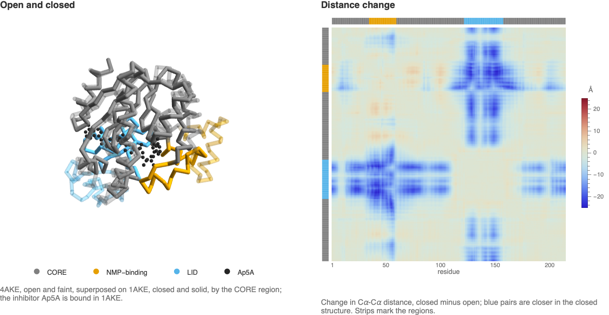

Compare two *E. coli* adenylate kinase structures:
[4AKE](https://www.rcsb.org/structure/4AKE) (open) and
[1AKE](https://www.rcsb.org/structure/1AKE) (closed, bound to the inhibitor Ap5A).
The bundled PDB files are unmodified, compressed copies distributed under CC0.

The examples below superpose the two structures and map how Cα distances change:



The goal is to locate structural differences and candidate bending regions.
Two crystal structures do not reveal a motion pathway or populations in solution.
Evaluate **Initialization**, then run the examples in order.

## Load and match the structures

```wl
{open, closed} = Import[FileNameJoin[{PacletObject["WolframInstitute/BioDataLink"]["AssetLocation", "Examples"], "AdenylateKinase", # <> ".pdb.gz"}], "BioMolecule"] & /@ {"4AKE", "1AKE"};
closed
```

Read the structure citations:

```wl
Dataset[KeyTake[First[BioMoleculeValue[#, "Citations"]], {"Journal", "Year", "Title"}] & /@ <|"4AKE" -> open, "1AKE" -> closed|>]
```

Use chain A in each structure and confirm identical sequences:

```wl
SameQ @@ (BioMoleculeValue[#, "BioSequences"]["A"] & /@ {open, closed})
```

Plot chain A from each structure:

```wl
GraphicsRow[BioMoleculePlot3D[BioMoleculeValue[#, "PolymerChains"]["A"]] & /@ {open, closed}, ImageSize -> Large]
```

The open structure is on the left; the closed structure folds around Ap5A.

## Compare internal distances

Extract the 214 alpha-carbon (Cα) positions in ångströms:

```wl
ca = BioMoleculeValue[#, "BackboneCoordinateValues"]["A"] & /@ {open, closed};
distances = DistanceMatrix /@ ca;
Dimensions[distances]
```

Subtract open-state distances from closed-state distances. Blue indicates
closer residue pairs; red indicates pairs farther apart.

```wl
Legended[MatrixPlot[distances[[2]] - distances[[1]],
    ColorFunction -> (ColorData["ThermometerColors"][Rescale[#, {-25, 25}]] &), ColorFunctionScaling -> False,
    PlotRange -> {-25, 25}, FrameLabel -> {"residue", "residue"}], BarLegend[{"ThermometerColors", {-25, 25}}]]
```

Nearly unchanged blocks suggest approximately rigid regions. Between some
blocks, distances shrink by about 25 Å.

## Define regions and align the core

Cluster distance-change patterns into three groups. Three is an explicit
analysis choice, not an estimated number of domains.

```wl
domains = ClusteringComponents[Abs[distances[[2]] - distances[[1]]], 3, 1, Method -> "KMeans", RandomSeeding -> 20261104];
```

List contiguous residue ranges in each group:

```wl
With[{runs = SplitBy[Range[Length[domains]], domains[[#]] &]}, Thread[(MinMax /@ runs) -> domains[[First /@ runs]]]]
```

The mobile stretches, residues 35–59 and 122–157, correspond to the NMP-binding
and LID domains described by
[Müller et al. 1996](https://doi.org/10.1016/S0969-2126%2896%2900018-4).
Label these groups and the remaining CORE:

```wl
domainName = AssociationThread[domains[[{1, 45, 140}]], {"CORE", "NMP-binding", "LID"}];
domainColor = AssociationThread[domains[[{1, 45, 140}]], {Gray, okabeIto[[1]], okabeIto[[2]]}];
```

Count residues in each region:

```wl
members = GroupBy[Range[Length[domains]], domainName[domains[[#]]] &];
Length /@ members
```

Align the open CORE to the closed CORE using a rigid rotation and translation:

```wl
aligned = Last[FindGeometricTransform[ca[[2, members["CORE"]]], ca[[1, members["CORE"]]], TransformationClass -> "Rigid"]] /@ ca[[1]];
```

Plot displacements after alignment:

```wl
ListPlot[byDomain[Range[Length[domains]], Norm /@ (aligned - ca[[2]])], Filling -> Axis, PlotStyle -> Values[domainColor],
    PlotLegends -> Values[domainName], Frame -> True, FrameLabel -> {"residue", "C\[Alpha] displacement (\[Angstrom])"}]
```

Aligned displacements reach about 24 Å in the LID, 18 Å in the NMP-binding
domain and 6 Å near CORE boundaries. These are differences between structures,
not distances traveled by atoms.

Show both chains; the open chain is translucent and Ap5A is black:

```wl
With[{colors = domainColor /@ domains, inhibitor = Flatten[BioMoleculeValue[closed, "AtomCoordinateValues"]["C"], 1]},
    Graphics3D[{Opacity[0.25], Tube[aligned, 0.6, VertexColors -> colors], Opacity[1], Tube[ca[[2]], 0.6, VertexColors -> colors],
        Black, Sphere[inhibitor, 0.5]}, Boxed -> False, Lighting -> "Neutral"]]
```

Fit each region separately and compute its root mean square deviation (RMSD):

```wl
fitRMSD[ca[[1, #]], ca[[2, #]]] & /@ members
```

The LID fits to about 0.4 Å, CORE to 2.3 Å and NMP-binding domain to 2.1 Å.
The latter two change internally as well as moving relative to the LID.

## Locate bending regions and ligand contacts

Compare backbone angles φ and ψ using the shorter circular difference.
Exclude the two terminal residues, which each lack one angle:

```wl
With[{angles = QuantityMagnitude[BioMoleculeValue[#, "RamachandranAngles"]["A"]][[2 ;; -2]] & /@ {open, closed}},
    ListPlot[byDomain[Range[2, Length[domains] - 1], Max /@ Abs[Mod[angles[[2]] - angles[[1]] + 180, 360] - 180]], Filling -> Axis,
        PlotRange -> All, PlotStyle -> Values[domainColor], PlotLegends -> Values[domainName], Frame -> True, FrameLabel -> {"residue", "largest change in \[Phi] or \[Psi] (degrees)"}]]
```

Eight residues change by more than 60°: 41, 42, 45, 46, 128, 129, 159 and 160.
These are candidate bending regions, not uniquely established hinges.

Count residues with any atom within 4 Å of Ap5A:

```wl
contactResidues = With[{atoms = BioMoleculeValue[closed, "AtomCoordinateValues"]["A"],
        toInhibitor = Nearest[Flatten[BioMoleculeValue[closed, "AtomCoordinateValues"]["C"], 1] -> "Distance"]},
    Select[Range[Length[atoms]], Min[toInhibitor[atoms[[#]]]] < 4 &]];
Counts[domainName /@ domains[[contactResidues]]]
```

The closed structure has contacts from 22 CORE residues and six from each
mobile domain. Contacts describe this structure, not binding occupancy in solution.

Crystal packing, chain choice and clustering can affect the comparison.
Other chains, structures or solution measurements are needed to test the
motion interpretation.

## Initialization

Okabe-Ito colors and helpers for regional plots and rigid-fit RMSD:

```wl
okabeIto = RGBColor /@ {"#E69F00", "#56B4E9", "#009E73", "#F0E442", "#0072B2", "#D55E00", "#CC79A7", "#000000"};
```

```wl
byDomain[residues_, values_] := Lookup[GroupBy[Transpose[{residues, values}], domainName[domains[[First[#]]]] &], Values[domainName]];
fitRMSD[a_, b_] := With[{fit = Last[FindGeometricTransform[b, a, TransformationClass -> "Rigid"]]}, RootMeanSquare[Norm /@ (fit /@ a - b)]];
```
