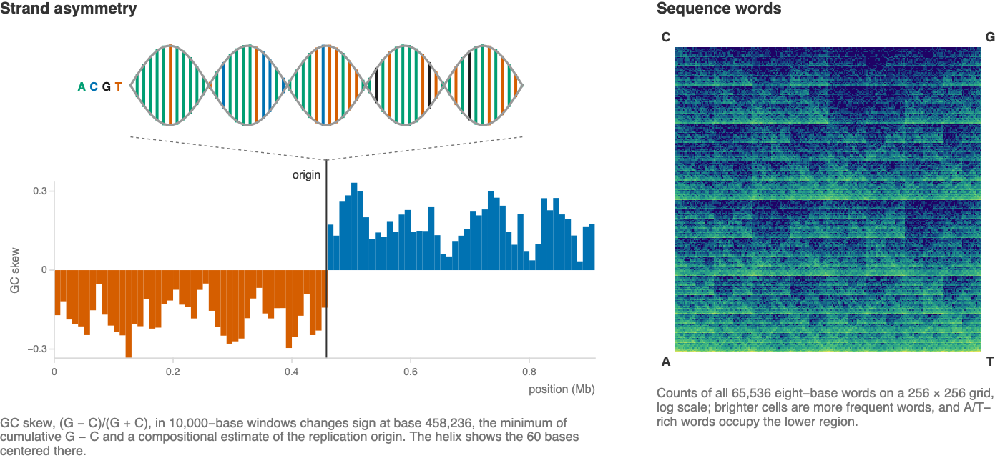

Examine strand composition and gene orientation in the linear chromosome of
*Borreliella* (*Borrelia*) *burgdorferi* B31. The bundled NCBI record
NC_001318.1 contains 910,724 bases and gene annotations
([Fraser et al. 1997](https://doi.org/10.1038/37551)); plasmids are excluded.

The examples below locate where strand composition reverses and count sequence words:



Evaluate **Initialization**, then run the examples in order.

## Load the sequence

```wl
genome = First[Import[FileNameJoin[{PacletObject["WolframInstitute/BioDataLink"]["AssetLocation", "Examples"], "BorreliaB31", "NC_001318.1.fasta.gz"}], "Sequence"]];
StringLength[genome]
```

Count bases and ambiguous symbols:

```wl
Counts[Characters[genome]]
```

About 29% of bases are G or C. A few positions contain ambiguity codes;
exact-word calculations omit words containing them.

## Measure strand asymmetry

GC skew is (G − C)/(G + C); AT skew is defined analogously.
Plot complete, nonoverlapping 10,000-base windows:

```wl
With[{windows = StringPartition[genome, 10000]},
    ListLinePlot[{skew[#, "G", "C"] & /@ windows, skew[#, "A", "T"] & /@ windows},
        DataRange -> {0.0050005, 0.9050005}, Filling -> Axis,
        PlotLegends -> {"GC skew", "AT skew"}, Frame -> True, FrameLabel -> {"position (Mb)", "skew"}]]
```

The sign reversal near the midpoint is consistent with replication-associated
strand asymmetry ([Lobry 1996](https://doi.org/10.1093/oxfordjournals.molbev.a025626)).
Locate the minimum of cumulative G minus C:

```wl
cumulative = Accumulate[Characters[genome] /. {"G" -> 1, "C" -> -1, _String -> 0}];
origin = First[Ordering[cumulative, 1]]
```

Plot cumulative GC skew:

```wl
With[{positions = Range[1, StringLength[genome], 1000]},
    ListLinePlot[Transpose[{positions, cumulative[[positions]]}], GridLines -> {{origin}, None},
        Frame -> True, FrameLabel -> {"position (bases)", "cumulative G \[Minus] C"}]]
```

The minimum at base 458,236 is near the experimentally mapped central
replication-origin region
([Picardeau et al. 1999](https://doi.org/10.1046/j.1365-2958.1999.01368.x)).
This is a compositional estimate, not a direct replication measurement.

## Compare gene orientations

Read gene start, end and strand. Preserve `-` as a strand label:

```wl
genes = Select[Import[FileNameJoin[{PacletObject["WolframInstitute/BioDataLink"]["AssetLocation", "Examples"], "BorreliaB31", "NC_001318.1.gff3.gz"}],
    "TSV", "MissingValuePattern" -> None], Length[#] == 9 && #[[3]] == "gene" &][[All, {4, 5, 7}]];
Length[genes]
```

Compare coding-sequence strand and position:

```wl
With[{plus = Select[genes, Last[#] == "+" &], minus = Select[genes, Last[#] == "-" &]},
    Graphics[{okabeIto[[5]], Rectangle[{#[[1]], 0}, {#[[2]], 1}] & /@ plus, okabeIto[[6]], Rectangle[{#[[1]], -1}, {#[[2]], 0}] & /@ minus,
        Black, Line[{{origin, -1.3}, {origin, 1.3}}]}, AspectRatio -> 1/6, Frame -> True, FrameTicks -> {{{{0.5, "+"}, {-0.5, "-"}}, None}, {Automatic, None}}, ImageSize -> Large]]
```

Count strand annotations on each side:

```wl
Counts /@ GroupBy[genes, If[#[[1]] < origin, "left of origin", "right of origin"] & -> Last]
```

About two thirds of genes on each side point away from the central region:
minus strand on the left, plus strand on the right. This agrees with the
orientation bias discussed by
[Rocha 2008](https://doi.org/10.1146/annurev.genet.42.110807.091653).

## Compare sequence-word frequencies

A [chaos-game grid](https://doi.org/10.1093/nar/18.8.2163) groups words by their
bases. A 256 × 256 grid counts 8-base words; brighter cells mean more frequent
words. A/T-rich words occupy the lower region:

```wl
BioSequenceCompositionPlot[genome, 8,
    FrameTicks -> {{{{1, "A"}, {256, "C"}}, None}, {{{1, "A"}, {256, "T"}}, None}}]
```

Compare 5-base words on either side of the compositional minimum:

```wl
With[{left = wordGrid[StringTake[genome, origin], 32], right = wordGrid[StringDrop[genome, origin], 32]},
    Legended[MatrixPlot[Log2[((right + 1)/Total[right + 1, 2])/((left + 1)/Total[left + 1, 2])], DataReversed -> True,
        ColorFunction -> (ColorData["ThermometerColors"][Rescale[#, {-2.5, 2.5}]] &),
        ColorFunctionScaling -> False, PlotRange -> {-2.5, 2.5}, FrameTicks -> None],
        BarLegend[{"ThermometerColors", {-2.5, 2.5}}]]]
```

Each side is normalized after adding one count per word. Red means more
frequent on the right; words crossing the split are excluded. The pattern
extends the single-base asymmetry to short sequence words.

These patterns describe one chromosome. Local selection, recombination and
horizontal transfer can alter composition; similar plots need not identify
replication origins accurately in other genomes.

## Compare resolutions without changing the sequence

Plot complete windows of 2,000, 10,000 and 40,000 bases with the same vertical
range. Smaller windows expose local variation; larger windows average it away.

```wl
GraphicsRow[Table[BioSequenceSkewPlot[genome, window, PlotRange -> {-0.3, 0.3},
    PlotLabel -> Row[{window, " bases"}]], {window, {2000, 10000, 40000}}], ImageSize -> Large]
```

Window size and discarded terminal bases belong in the analysis record.
Different resolutions can support a broad compositional pattern while disagreeing
about local fluctuations. This display alone does not measure a replication
process.

## Separate global composition from sequential arrangement

Shuffle the characters of the sequence. This preserves the total count of every
base and ambiguity symbol but removes their order. Compare the original and
shuffled four-base-word maps on a common log-count color range:

```wl
shuffledGenome = BlockRandom[SeedRandom[20261106]; StringJoin[RandomSample[Characters[genome]]]];
wordCountRange = {0, Max[Log[1. + wordGrid[#, 16]] & /@ {genome, shuffledGenome}]};
GraphicsRow[MapThread[BioSequenceCompositionPlot[#1, 4, PlotRange -> wordCountRange,
    ColorFunction -> (ColorData["BlueGreenYellow"][Rescale[#, wordCountRange]] &), ColorFunctionScaling -> False,
    PlotLegends -> None, PlotLabel -> #2] &, {{genome, shuffledGenome}, {"observed order", "shuffled order"}}], ImageSize -> Large]
```

Shared broad patterns can arise from base frequencies alone. Differences from
the shuffle reflect ordering beyond those frequencies; they do not identify
which evolutionary or molecular process generated it.

Compare the distributions of complete-word counts, including words absent
from a sequence:

```wl
Histogram[Log[1. + Flatten[wordGrid[#, 64]]] & /@ {genome, shuffledGenome}, Automatic, "Probability",
    ChartLegends -> {"observed order", "shuffled order"}, Frame -> True,
    FrameLabel -> {"log(1 + six-base-word count)", "fraction of possible words"}]
```

The grid and histogram summarize the same counts in different ways. The grid
preserves sequence-word relationships; the histogram makes their spread easier
to compare.

## Keep denominators explicit as word length increases

Longer words create exponentially more possible categories. Count distinct
observed words and the fraction of the possible vocabulary represented in the
sequence:

```wl
wordLengths = Range[1, 8];
occupiedWords = Count[Flatten[wordGrid[genome, 2^#]], _?Positive] & /@ wordLengths;
Grid[{{
    ListLogPlot[{4^wordLengths, occupiedWords}, Joined -> True, PlotLegends -> {"possible words", "observed words"},
        Frame -> True, FrameLabel -> {"word length", "number of words"}, ImageSize -> 300],
    ListPlot[N[occupiedWords/4^wordLengths], Joined -> True, PlotRange -> {0, 1},
        Frame -> True, FrameLabel -> {"word length", "fraction of vocabulary observed"}, ImageSize -> 300]}}]
```

An absent long word can be a consequence of limited sequence length.
Comparisons across word lengths need the possible vocabulary and number of
complete windows, not just the number of nonzero grid cells.

## Test ambiguity handling on an inspectable control

Use short synthetic strings to see exactly what happens at an unknown base.
A word may not cross `N`; deleting `N` would invent an adjacency:

```wl
GraphicsRow[MapThread[BioSequenceCompositionPlot[#1, 2, "CountScaling" -> "Linear",
    PlotLegends -> None, PlotLabel -> #2] &, {{"AACNCTT", "AACCTT"}, {"unknown position retained", "unknown position incorrectly deleted"}}]]
```

This control illustrates a representation decision, not a biological difference.
Keep ambiguity positions when counting exact words and record any masking or
selection separately from the source sequence.

## Initialization

`skew` compares two base counts. `wordGrid` counts complete words within
uninterrupted A/C/G/T runs, so ambiguity codes cannot join separated words.
The grid size must be a power of two; A/T are at the bottom and C/G at the top.

```wl
okabeIto = RGBColor /@ {"#E69F00", "#56B4E9", "#009E73", "#F0E442", "#0072B2", "#D55E00", "#CC79A7", "#000000"};
skew[sequence_, a_, b_] := N[(StringCount[sequence, a] - StringCount[sequence, b])/StringCount[sequence, a | b]];
wordGrid[sequence_, n_] := Module[{k = IntegerExponent[n, 2], words, points},
    words = Select[StringCases[sequence, RegularExpression["[ACGT]+"]], StringLength[#] >= k &];
    points = Catenate[Function[run, With[{digits = Characters[run] /. {"A" -> 0, "C" -> 1, "G" -> 3, "T" -> 2}},
        Transpose[{ListCorrelate[2^Range[0, k - 1], Quotient[digits, 2]],
            ListCorrelate[2^Range[0, k - 1], Mod[digits, 2]]}]]] /@ words];
    Transpose[BinCounts[points, {-0.5, n - 0.5, 1}, {-0.5, n - 0.5, 1}]]];
```
